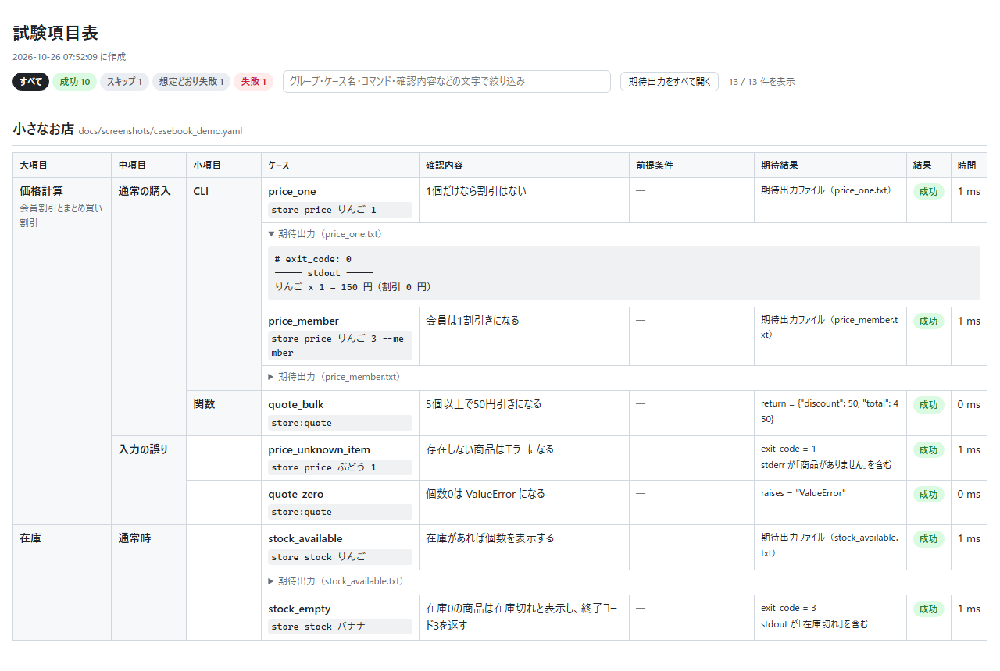
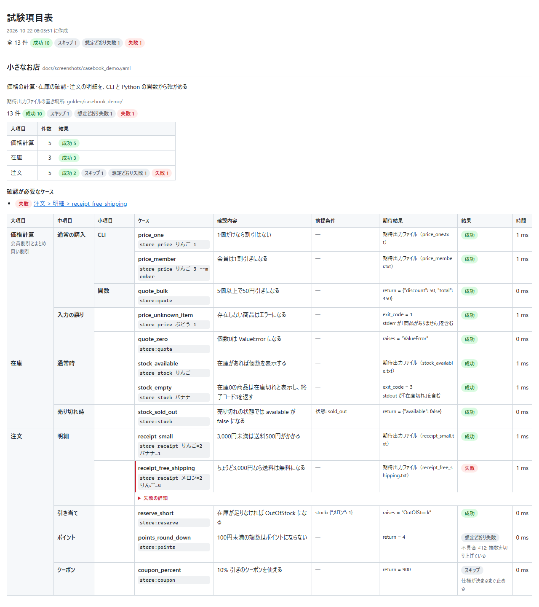
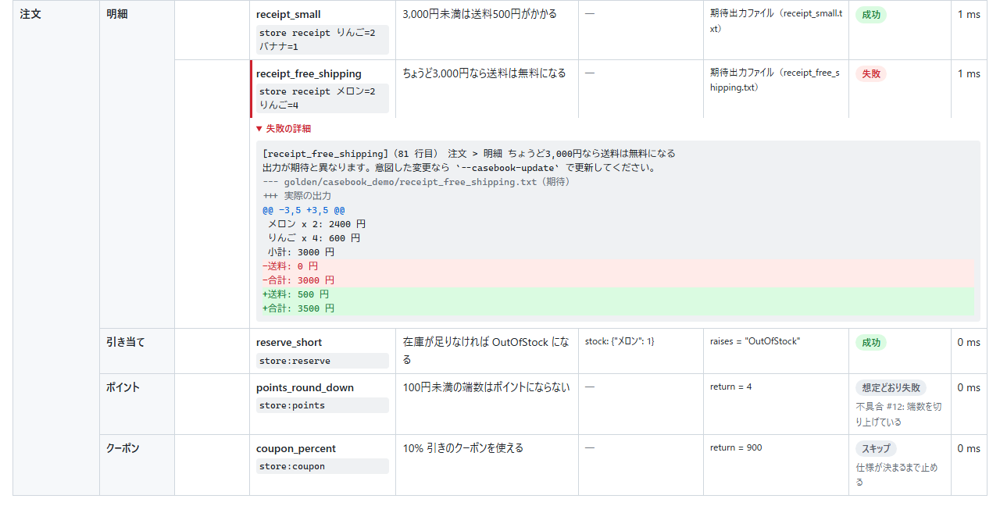

# pytest-casebook

[English](README.md) | 日本語

YAML に書いたテストケースを pytest で実行し、結果を、大項目・中項目・小項目で整理した**試験項目表**（HTML）として出力する pytest プラグインです。\
Excel の試験項目表と自動テストを別々に管理して、内容がずれていく問題をなくします。

## できること

- **CLI を実行**して、終了コード・標準出力・標準エラーを確かめる
- **Python の関数を呼んで**、戻り値や例外を確かめる（async の関数も）
- **HTTP の API にリクエストを送って**、ステータス・JSON・ヘッダーを確かめる（FastAPI や Flask などのテスト用クライアントで送る。[書き方](#http-の-api-request)）
- **前提条件を用意する**: ファイルを置く、DB に行を入れる、「障害時」のような状態に切り替える（[書き方](#前提条件-setup)）
- **実行後の DB やファイルの中身**も確かめる（[書き方](#実行後の値-observe)）
- 期待結果は **YAML に直接書く**か、実際の出力から**期待出力ファイルを作って差分で比べる**（[書き方](#期待結果-expect)）
- ケースを**大項目・中項目・小項目**（何階層でも）に分け、**試験項目表の HTML** を出す（日本語・英語。[書き方](#html-レポート)）

`pytest --casebook-html=report.html` を実行すると、YAML に書いたケースが、次のような試験項目表として出力されます。\
グループの階層の列は縦に結合され、前提条件・期待結果・結果が1行に並びます。



> **レポートを日本語にする**: HTML レポートとメッセージ（比較の失敗、YAML の書き方の誤りなど）の既定は英語です。\
> 日本語にするときは、`pyproject.toml` に一度だけ書きます（[ini の設定](#ini-の設定)）。
>
> ```toml
> [tool.pytest.ini_options]
> casebook_lang = "ja"
> ```

上の表は、次の YAML から作りました（抜粋。全体は [docs/screenshots/casebook_demo.yaml](docs/screenshots/casebook_demo.yaml)）。\
`group:` の入れ子が大項目・中項目・小項目の列に、`description` が確認内容の列に、`expect:` が期待結果の列になります。\
`expect:` のないケースは、期待出力ファイルと比べます。

```yaml
title: 小さなお店
levels: [大項目, 中項目, 小項目]
command_prefix: store

cases:
  - group: 価格計算
    description: 会員割引とまとめ買い割引
    cases:
      - group: 通常の購入
        cases:
          - group: CLI
            cases:
              - name: price_one
                description: 1個だけなら割引はない
                command: price りんご 1
          - group: 関数
            cases:
              - name: quote_bulk
                description: 5個以上で50円引きになる
                call: store:quote
                args: [バナナ, 5]
                expect:
                  return: {discount: 50, total: 450}
```

## 向いている場面

Python のまま書けば、型の補完もデバッガも使えます。\
単体のテストなら `@pytest.mark.parametrize` とスナップショットテスト（syrupy など）で十分です。\
pytest-casebook が向いているのは、次のような場面です。

- テストの一覧を、エンジニア以外（QA・顧客・企画）にも見せたい。\
  試験項目表として提出したい
- ケースは QA を含む多くの人が YAML で増やし、DB の準備などの仕組み（conftest.py の hook）はエンジニアが一度だけ書く、という分担にしたい
- 「DB に行を入れる → API や CLI を動かす → レスポンスと DB の変化を確かめる」を、1つのケースとして書きたい
- 同じ YAML を、デモ用のスクリプトなど pytest の外でも使いたい（`pytest_casebook.load()`）

対応する Python は 3.11〜3.15、pytest は 8 と 9 です（GitHub Actions の CI と [scripts/check.sh](scripts/check.sh) で確かめています）。

## インストール

```bash
pip install pytest-casebook
# uv を使っているなら
uv add --dev pytest-casebook
```

Python 3.11 以上と pytest 8 以上で動きます。\
インストールするだけで pytest に読み込まれ、設定は要りません。

Python 3.15 では、PyYAML に 3.15 用の wheel がまだないため、インストールのときに PyYAML がソースからビルドされます。\
C コンパイラのない Windows で失敗するときは、環境変数 `PYYAML_FORCE_LIBYAML=0` を付けて入れてください（C 拡張を使わない PyYAML になります）。

依存は pytest・PyYAML・pluggy（pytest にも含まれる）だけです。\
HTTP の API を確かめるときも、HTTP のライブラリは増えません（リクエストは、FastAPI や Flask などフレームワークのテスト用クライアントで送ります）。

## はじめかた: 作るのは YAML 1つだけ

CLI を実行して確かめるだけなら、作るのは YAML のファイル1つです。\
conftest.py も Python のテストコードも要りません。\
ここでは、名前を渡すとあいさつを表示する、自作の CLI `hello` を確かめます。

```text
myproject/
└── tests/
    ├── casebook_hello.yaml        ← 1. これを作る
    └── golden/casebook_hello/     ← 2. pytest --casebook-update で自動で作られる
        └── greet.txt
```

**1. `tests/casebook_hello.yaml` を作る**

ファイル名は `casebook_` で始めます（`*.casebook.yaml` でも構いません）。

```yaml
# yaml-language-server: $schema=https://raw.githubusercontent.com/gyuro-dev/pytest-casebook/main/src/pytest_casebook/casebook.schema.json
title: hello コマンド
command_prefix: [hello]              # どのケースでも先頭に付ける部分（確かめたいコマンド）

cases:
  - name: greet                         # ケース名（英数字・_・-・.）
    description: 名前を渡すとあいさつする
    command: --name 佐藤

  - name: greet_error
    description: 名前を渡さないとエラーになる
    command: --name
    expect:                             # 期待結果を YAML に書くこともできる
      exit_code: 2
      stderr: {contains: --name}
```

各ケースは `hello --name 佐藤` のように、`command_prefix` と `command` をつないで実行します。\
実行するディレクトリは YAML のあるディレクトリ（ここでは `tests/`）なので、コマンドはそこから実行できる必要があります（インストール済みのコマンドや、`[python, "{casebook_dir}/../hello.py"]` のようにパスで指したスクリプトなど）。

**2. 期待出力ファイルを作る**

```bash
uv run pytest --casebook-update
```

（uv を使っていなければ `pytest --casebook-update`。以下のコマンドも同じです）

`expect:` を書いていないケース（ここでは greet）は、実際の出力から `tests/golden/casebook_hello/<ケース名>.txt` が作られます。\
`expect:` を書いたケースは、YAML の期待結果と比べるだけで、ファイルは作りません。

```text
# case: greet
# command: hello --name 佐藤
# exit_code: 0
----- stdout -----
こんにちは、佐藤さん
```

比べるのは結果（`# exit_code:` と `-----` の見出しより下）だけです。\
`# case:` や `# command:` の行は読む人のための説明なので、期待出力ファイルを手で書くときは省けます。\
出力が1つだけなら、本文だけを書けば十分です（[期待出力ファイルの書き方](#期待出力ファイル)）。

```text
こんにちは、佐藤さん
```

**3. 中身を確かめて commit する**

期待出力ファイルの中身が正しいことを確かめて、YAML と一緒に commit します。\
これ以降は、`uv run pytest` を実行するたびに、実際の出力をこのファイルと比べます。\
動きを変えたときは `--casebook-update` で作り直し、git の差分で変わったところを確かめます。

**結果を表で見る**

```bash
uv run pytest --casebook-html=reports/casebook.html
```

レポートの既定は英語です。\
日本語にするときは、`pyproject.toml` に一度だけ書きます。

```toml
[tool.pytest.ini_options]
casebook_lang = "ja"
```

### 用語

| 用語 | 意味 |
|---|---|
| ケース | 確かめることの1件。YAML の `cases:` に1つずつ書く（試験項目表の1行） |
| ケースファイル | ケースを書いた YAML（`casebook_*.yaml`） |
| グループ | ケースの分類（`group:`）。入れ子にすると大項目・中項目・小項目になる |
| 期待出力ファイル | 実際の出力から作る「正しい結果」のファイル（ゴールデンファイル）。`--casebook-update` で作る |
| `expect:` | 期待結果を YAML に直接書く書き方。書いたときは期待出力ファイルを使わない |
| hook | conftest.py に書く、決まった名前の関数（`pytest_casebook_…`）。DB の準備など、YAML だけでは書けない部分を受け持つ |
| `casebook_env` | conftest.py で用意する「環境」（DB の接続やモックなど）。各 hook に `env` として渡る |

## やりたいことから探す

ほとんどのことは YAML だけでできます。\
DB を使うときや、テスト用の環境を渡したいときだけ、conftest.py に hook（決まった名前の関数）を足します。

表の各行には、そのまま動くサンプルを [examples](examples) に用意しています（カバレッジの行を除く）。\
サンプルのディレクトリをコピーして、名前を書き換えるところから始められます。

| やりたいこと | 書く場所 | 書くもの | サンプル |
|---|---|---|---|
| CLI を実行して、出力を確かめたい | YAML | `command_prefix` と `command` | [01_cli](examples/01_cli) |
| Python の関数を呼んで、戻り値を確かめたい | YAML | `call: モジュール:関数` と `args` / `kwargs` | [02_function](examples/02_function) |
| 例外になることを確かめたい | YAML | `expect: {raises: ValueError}` | [03_exception](examples/03_exception) |
| 期待結果を YAML に直接書きたい | YAML | `expect:`（[書き方](#期待結果-expect)） | [04_expect](examples/04_expect) |
| ケースを大項目・中項目・小項目に分けたい | YAML | `group:` の入れ子（[書き方](#グループ)） | [05_groups](examples/05_groups) |
| 入力ファイルを置いてから実行したい / できたファイルを確かめたい | YAML | `setup: {files: ...}` と `observe: [files]` | [06_files](examples/06_files) |
| 同じ操作を「通常時」「障害時」で確かめたい | YAML ＋ conftest.py | `states:` ＋ `pytest_casebook_setup` | [07_states](examples/07_states) |
| DB に行を入れてから実行し、実行後の DB を確かめたい | YAML ＋ conftest.py | `casebook_env`・`pytest_casebook_setup`・`pytest_casebook_observe`・`pytest_casebook_prepare_call` | [08_db](examples/08_db) |
| CLI を同じプロセスで動かして、モックを渡したい | YAML ＋ conftest.py | `pytest_casebook_run_command` ＋ `run_in_process` | [09_in_process](examples/09_in_process) |
| 実行のたびに変わる ID・日時をそろえたい | YAML | `normalize:`（hook でも書ける） | [10_normalize](examples/10_normalize) |
| ケースに自分用の情報を付け、同じ YAML を pytest の外でも使いたい | YAML ＋ Python | `meta:` と `pytest_casebook.load()` | [11_meta_load](examples/11_meta_load) |
| 期待出力ファイルを手で書きたい | 期待出力ファイル | 本文だけ（ヘッダーは省ける） | [12_handwritten_golden](examples/12_handwritten_golden) |
| 理由を付けてケースを止めたい / 既知の不具合を書いておきたい | YAML | `skip: 理由` / `xfail: 理由` | [13_skip_xfail](examples/13_skip_xfail) |
| HTTP の API を呼んで、ステータスやレスポンスを確かめたい | YAML ＋ conftest.py | `request:` ＋ `pytest_casebook_request` | [14_http_hook](examples/14_http_hook) |
| FastAPI の API と DB を確かめたい | YAML ＋ conftest.py | `request:`・`setup:`・`expect:` ＋ TestClient | [15_fastapi](examples/15_fastapi) |
| Flask の API と DB を確かめたい | YAML ＋ conftest.py | `request:`・`setup:`・`expect:` ＋ test_client | [16_flask](examples/16_flask) |
| 同じケースを別々の環境（ローカルとステージング、モックと本物など）に流したい | conftest.py ＋ コマンドライン | `casebook_env` で切り替え、`-o casebook_golden_dir=…` と `-m`（[やり方](#複数の環境に流す)） | [17_targets](examples/17_targets) |
| 試験の前に、これから確かめる項目の表を出したい | コマンドライン | `pytest --collect-only --casebook-html=plan.html`（結果は「未実施」。[やり方](#html-レポート)） | — |
| HTML レポートを出しながら、カバレッジも測りたい | pyproject.toml ＋ コマンドライン | pytest-cov と、coverage.py の `patch = ["subprocess"]`（[やり方](#カバレッジを測る)） | — |

全部を組み合わせた例は [examples/shop](examples/shop) にあります。

日時（`2026-10-19T12:34:56Z` など）と UUID は、何もしなくても `<datetime>` / `<uuid>` に置き換えてから比べます。

YAML を書くときの注意です。

- 値の途中に `: `（コロンと空白）や ` #`（空白とシャープ）があると、YAML の区切りやコメントとして読まれます。\
  `description: "setup: の説明"` のように、値全体を `"` で囲んでください
- `command:` にファイルのパスを書くときは、`/` で区切ってください（`C:/data/in.csv`）。\
  文字列の command は shell と同じ書き方で区切るため、`\` が消えます。\
  `\` のまま書きたいときは、`command: ['C:\data\in.csv']` のようにリストで書きます
- エディタで補完と検証を使えます（[エディタでの補完と検証](#エディタでの補完と検証)）
- `call:` で呼ぶモジュールは、YAML と同じディレクトリに置けば import できます。\
  ただし、ディレクトリが違っても同じ名前のモジュール（たとえば2か所の `utils.py`）は、先に import したほうが使われます。\
  モジュール名はプロジェクトの中で重ならないようにしてください

## 完成例: DB を使う関数を確かめる

DB を使うときは、YAML ＋ conftest.py の2つを作ります。

```text
myproject/
├── orders.py                      ← 確かめたい関数（place_order）
└── tests/
    ├── conftest.py                ← DB の用意・行の投入・行の取り出し
    └── casebook_orders.yaml       ← ケース
```

**tests/casebook_orders.yaml**

```yaml
title: 注文
levels: [大項目, 中項目]

cases:
  - group: 注文する
    cases:
      - group: 在庫がある
        cases:
          - name: order_ok
            description: 在庫が減り、注文が1行増える
            setup:
              db:                                      # pytest_casebook_setup に渡る
                stock: [{item: apple, count: 10}]
            call: orders:place_order
            args: [apple, 3]
            expect:
              return: {item: apple, quantity: 3}       # 書いたキーだけを比べる
              db.stock: [{item: apple, count: 7}]      # pytest_casebook_observe で取り出す
              db.orders: [{item: apple, quantity: 3}]
      - group: 在庫が足りない
        cases:
          - name: order_out_of_stock
            description: 例外になり、DB は変わらない
            setup:
              db:
                stock: [{item: melon, count: 2}]
            call: orders:place_order
            args: [melon, 5]
            expect:
              raises: OutOfStock
              db.stock: [{item: melon, count: 2}]
              db.orders: []
```

**tests/conftest.py**

```python
import contextlib
import sqlite3

import pytest


@pytest.fixture(scope="session")
def casebook_env():
    """テストで使う DB を用意する。この値が各 hook の env に渡る。"""
    conn = sqlite3.connect(":memory:")
    conn.execute("create table stock (item text primary key, count integer)")
    conn.execute("create table orders (id integer primary key, item text, quantity integer)")
    yield conn
    conn.close()


@contextlib.contextmanager
def _insert(conn, tables):
    for table, rows in tables.items():
        for row in rows:
            marks = ", ".join("?" for _ in row)
            conn.execute(
                f"insert into {table} ({', '.join(row)}) values ({marks})", list(row.values())
            )
    try:
        yield
    finally:  # ケースが終わったら消す（次のケースに影響しないように）
        conn.execute("delete from stock")
        conn.execute("delete from orders")


def pytest_casebook_setup(env, data):
    """YAML の setup: の内容（files 以外）を受け取って準備する。"""
    return _insert(env, data.get("db", {}))


def pytest_casebook_prepare_call(env, args):
    """関数の先頭の引数に DB の接続を渡す。"""
    args.insert(0, env)


def pytest_casebook_observe(target, env):
    """observe: / expect: の db.<テーブル名> を取り出す。並び順は必ずそろえる。"""
    if target.startswith("db."):
        cur = env.execute(f"select * from {target[3:]} order by 1")
        columns = [d[0] for d in cur.description]
        return [dict(zip(columns, row)) for row in cur]
    return None
```

期待結果と違うときは、違う箇所を1つずつ並べ、そのあとに実際の値を1件1行で出します。

```text
[order_ok]（9 行目） 注文する > 在庫がある 在庫が減り、注文が1行増える
期待結果と違います:
  - db.stock[0].count: 期待 7 / 実際 10
----- 実際の db.stock -----
{"item": "apple", "count": 10}
```

[examples/shop](examples/shop) に、ここまでの書き方をすべて使ったサンプルがあります（CLI・関数・3階層・状態・ファイル・sqlite の DB）。

```bash
uv run pytest examples/shop -o casebook_lang=ja --casebook-html=reports/shop.html
```

---

## リファレンス

### YAML の全体

```yaml
title: 見出し                  # レポートの見出し（省略時はファイル名）
description: 説明
levels: [大項目, 中項目, 小項目] # 階層の呼び名。いくつでも（省略時は ini の casebook_levels）
command_prefix: [python, -m, mytool]  # {casebook_dir} は YAML のあるディレクトリになる
states:                        # 状態名 -> 内容（名前を付けた setup:。下の「状態」を参照）
  default: {}
  outage: {db: down}
golden_dir: golden             # 期待出力の置き場所（このファイルからの相対パス）
check_orphans: true            # ケースのない期待出力ファイルが残っていたら失敗にする
normalize:                     # 出力に当てる置き換え
  - {pattern: 'req-[0-9a-f]+', replace: '<request-id>'}
meta: {owner: qa}              # 自由に使う情報（下の「meta」を参照）
cases: [...]                   # ケースまたはグループのリスト
```

### グループ

```yaml
- group: 価格計算           # 名前（入れ子の深さがそのまま階層になる）
  description: 説明
  state: outage            # 中のケースの既定の状態
  marks: [slow]            # 中のケースに付ける pytest のマーク
  meta: {area: price}      # 中のケースに付ける meta
  skip: 仕様が決まるまで止める  # 中のケースすべてを、この理由でスキップする（xfail: も書ける）
  cases: [...]
```

`-k 価格計算` のように、グループ名で絞り込んで実行できます。\
HTML レポートの階層の列は、実際に使われているグループの深さだけ出します（`levels` に3つ書いても、グループが1階層なら列は1つです）。

### ケース

| キー | 内容 |
|---|---|
| `name` | ケース名。期待出力のファイル名になるので、英数字・`_`・`-`・`.` で書く |
| `description` | 確認する内容 |
| `command` | CLI として実行する引数（shell と同じ書き方で区切る）。`command_prefix` の後ろに付く。`command_prefix` があれば空文字（`""`）でもよい。リスト（`[a, 'b c']`）で書くと区切らずにそのまま渡す |
| `stdin` / `timeout` | command の標準入力 / 打ち切るまでの秒数 |
| `call` | 呼び出す関数（`モジュール:関数`、`モジュール:クラス.メソッド`）。`async def` の関数は終わるまで待つ |
| `args` / `kwargs` | 関数に渡す引数 |
| `request` | 送る HTTP のリクエスト（`"POST /users"` か、method・path・query・headers・json・body。[書き方](#http-の-api-request)） |
| `state` | 状態名（`states:` に書いたもの） |
| `setup` | 前提条件。`files`（作業ディレクトリに置くファイル）と、`pytest_casebook_setup` に渡す内容 |
| `observe` | 実行後に取り出す対象。`files`（組み込み）か、`pytest_casebook_observe` で取り出す名前 |
| `expect` | 期待結果。書いたときは期待出力ファイルを使わない |
| `marks` | pytest のマーク名のリスト |
| `skip` / `xfail` | 止める理由 / 失敗すると分かっている理由。ターミナル（`pytest -rsx`）と HTML の結果の列に出る |
| `meta` | 自由に使う情報（[meta](#meta)） |
| `golden` | 期待出力のファイル名（省略時は `<name>.txt`） |

`command`・`call`・`request` は、どれか1つだけを書きます。\
上の表にないキーは、打ち間違いを見つけるためにエラーにします。\
自分で使う情報は `meta:` の中に書きます。

### meta

`meta:` の中身を、pytest-casebook は見ません。\
プロジェクトで自由に使う情報（デモで見せるケースの印、担当者、実行する環境の制限など）を書く場所です。

```yaml
- group: IPv6
  meta: {moto_only: true}       # グループに書くと、中のケースすべてに付く
  cases:
    - name: find_ipv6
      command: find 2001:db8::31
      meta: {demo: true}        # グループの meta に重ね、同じキーはケースの値で上書きする
```

- hook では `case.meta` で読めます（上の例の find_ipv6 は `{"moto_only": True, "demo": True}`）
- ファイル全体の `meta:` は `doc.meta` で読めます
- pytest の `-m` で絞り込みたいときは、`meta:` ではなく `marks:` を使います

### pytest の外から読む (load)

テストと同じ YAML を、デモ用のスクリプトなど pytest の外でも使えます。

```python
import pytest_casebook

doc = pytest_casebook.load("tests/casebook_demo.yaml")
for case in doc.cases:
    if case.meta.get("demo"):
        print(" > ".join(case.path), case.name, case.command)
```

`load()` は pytest で集めるときと同じ検証をして、`CasebookDoc`（`title`・`levels`・`states`・`meta`・`cases` など）を返します。\
書き方に誤りがあれば `pytest_casebook.CasebookError` を出します。

### 前提条件 (setup)

- `setup.files` があると、ケースごとに一時的な作業ディレクトリを作ってファイルを置き、command も call もそのディレクトリで実行します。\
  出力に出るそのディレクトリのパスは `<tmp>` に置き換えます
- 作業ディレクトリは YAML のディレクトリとは別の場所です。\
  YAML の隣のスクリプトなどは `{casebook_dir}` を付けて指します（例: `command_prefix: [python, "{casebook_dir}/tool.py"]`）。\
  出力に出る YAML のディレクトリのパスは `{casebook_dir}` に置き換えます
- `files` 以外の内容は `pytest_casebook_setup` に渡します。\
  hook がコンテキストマネージャを返すと、observe のあとにそれを抜けます（後片付けに使えます）
- 準備はケースごとにやり直すので、前のケースの影響は残りません

### 状態 (states)

状態は「名前を付けた setup:」です。\
何度も使う前提条件に名前を付けておき、ケースやグループの `state:` で選びます。

```yaml
states:
  default:
    flags: {maintenance: false}
  maintenance:
    flags: {maintenance: true}
    files: {notice.txt: メンテナンス中}

cases:
  - name: during_maintenance
    state: maintenance
    setup:
      db: {users: [...]}     # 状態の内容に重ね、同じキーはケースの値で上書きする
    call: app:handle
```

- 選んだ状態の内容にケースの `setup:` を重ね（同じキーはケースの値で上書きする）、`pytest_casebook_setup` の `data` に渡します（`files` はファイル名ごとに重ねます）
- `state:` を書かないケースは `default` の状態になります
- 状態の書き方は `setup:` と同じで、書き方の誤りも同じように確かめます

### 期待出力ファイル

`--casebook-update` は、次の形で期待出力ファイルを作ります。

```text
# case: price_member
# command: shop price apple 3 --member
# state: sold_out
# exit_code: 0
----- stdout -----
apple x 3 = 324 円
----- stderr -----
（stderr があるときだけ）
```

比べるのは、結果である `# exit_code:`（request なら `# status:`）と、`----- 見出し -----` より下の本文だけです。

- `# case:`・`# command:`・`# call:`・`# args:`・`# kwargs:`・`# state:` の行は説明で、比べません。\
  手で書くときは省けます
- `# exit_code:` / `# status:` を書かなければ、終了コード / ステータスは比べません
- 見出しのない本文は、command なら stdout、call なら return、request なら json として扱います。\
  出力が1つだけなら、本文だけを書けば十分です
- 書いていない見出しは、空であることを期待します（stderr の見出しがなければ、stderr は空でなければなりません）
- `--casebook-update` は、結果が変わったときだけファイルを書き直します。\
  手で書いた期待出力ファイルは、結果が同じなら書き方を変えません
- ケースを消したのに期待出力ファイルだけが残っていると、`golden_orphans` という確認が失敗します（サブディレクトリの中も見ます）。\
  調べるのは `.txt` と、`golden:` で使った拡張子（`.json` など）のファイルです。置き場所に置いたメモなど、ほかのファイルは知らせません。\
  同じディレクトリのほかのケースファイルが使う期待出力は「使われている」と数えるので、複数の YAML で `golden_dir:` を共有しても、消し忘れと誤って報告しません。\
  この確認を止めるときは、YAML に `check_orphans: false` を書きます

### HTTP の API (request)

`request:` のケースは、HTTP のリクエストを送ってレスポンスを確かめます。\
pytest-casebook 自身は HTTP を送りません。\
送るのは conftest.py の `pytest_casebook_request` で、フレームワークのテスト用クライアントを使います。

```yaml
request_defaults:                     # どのリクエストにも付けるヘッダー（ケースで上書きできる）
  headers: {Authorization: Bearer test-token}

cases:
  - name: list
    request: GET /todos                # "メソッド パス" の文字列（メソッドを省くと GET）
  - name: create
    request:                           # マッピングでも書ける
      method: POST
      path: /todos
      query: {notify: true}            # /todos?notify=true
      headers: {X-Request-Id: abc}
      json: {title: 牛乳を買う}         # JSON 以外を送るときは body: に文字列
    expect:
      status: 201
      json: {title: 牛乳を買う}         # 書いたキーだけを比べる
      headers: {Location: {regex: '^/todos/\d+$'}}
      db.todos: [{title: 牛乳を買う}]   # DB の変化も確かめられる
```

conftest.py には、リクエストを送る hook を書きます。\
よく使うクライアント向けのアダプターを `pytest_casebook.http` に用意しています（アダプターはクライアントのメソッドを呼ぶだけで、フレームワークを import しません）。

```python
from pytest_casebook.http import send_with_httpx_client, send_with_werkzeug_client


# FastAPI / Starlette の TestClient（httpx の API を持つクライアント）
def pytest_casebook_request(request, env):
    return send_with_httpx_client(env.client, request)


# Flask の test_client（Werkzeug のクライアント）
def pytest_casebook_request(request, env):
    return send_with_werkzeug_client(env.client, request)
```

ほかのクライアントでも、`request`（`HttpRequest`: `method`・`path`・`url`・`query`・`headers`・`json`・`body`）を読んで `HttpResponse(status, body, headers)` を返せば使えます（[14_http_hook](examples/14_http_hook) はフレームワークなしの例です）。

期待出力ファイルには `# status:` と、本文が JSON なら整形した `----- json -----`、それ以外なら `----- body -----` を書きます。\
レスポンスのヘッダーは期待出力ファイルに書きません（日時などで毎回変わるため）。\
ヘッダーを確かめるときは `expect:` の `headers` を使います。

### 実行後の値 (observe)

- 期待出力ファイルを使うケースでは、取り出した値を `----- observe: <対象> -----` として期待出力に加えます
- リスト（DB の行など）は、1件を1行の JSON にして書きます。\
  値が変わったときに差分がその行だけに出ます
- `files` は、作業ディレクトリのファイルとその中身を `=== ファイル名 ===` の形で書きます

### 期待結果 (expect)

```yaml
expect:
  exit_code: 1                          # command
  stdout: ""                            # 文字列は完全一致（末尾の改行は問わない）
  stderr: {contains: エラー}             # {contains: ...} 含む / {regex: ...} 正規表現
  return: {item: apple}                 # call。辞書は書いたキーだけを比べる
  raises: ValueError                    # call。型名（継承した型も一致）
  db.stock: [{item: apple, count: 7}]   # 上記以外は observe の対象
```

| 項目 | 書けるケース | 比べ方 |
|---|---|---|
| `exit_code` | command | 整数の完全一致 |
| `status` | request | 整数の完全一致 |
| `json` | request | レスポンスの本文を JSON として読み、`return` と同じ方法で比べる |
| `body` | request | 本文の文字列。`stdout` と同じ比べ方 |
| `headers` | request | ヘッダー名 -> 期待値。書いたヘッダーだけを、名前の大文字小文字を区別せずに比べる。値は `stdout` と同じ比べ方 |
| `stdout` / `stderr` | command・call | 文字列なら完全一致、`{contains: ...}` なら含む、`{regex: ...}` なら正規表現 |
| `return` | call | 辞書は書いたキーだけ、リストは件数と各要素、それ以外は完全一致 |
| `raises` | call | 下の表のとおり |
| 上記以外（`db.users`・`files` など） | すべて | observe の対象として取り出し、`return` と同じ方法で比べる |

| `raises` の書き方 | 一致する例外 |
|---|---|
| `ValueError` | ValueError と、それを継承した例外 |
| `mypkg.errors.AppError` | モジュール名まで同じ型と、それを継承した例外 |
| `Outer.Inner` | クラスの中に定義した例外 |
| `"ValueError: 個数は1以上にしてください"` | 型は上と同じ比べ方で、メッセージは完全一致 |
| `{contains: ...}` / `{regex: ...}` | `実際の型名: メッセージ` の文字列に含む / 正規表現に合う |

call で例外が出たのに `raises` を書いていない場合は失敗にします。

`return`・`json`・observe の対象（`db.*` など）の値の中では、`$` で始まる比べ方を使えます。\
`$` を付けるのは、`contains` などのキーを本当に持つデータと区別するためです。

```yaml
expect:
  json:
    message: {$contains: 在庫が足りません}     # この文字列を含む
    code: {$regex: '^E\d{3}$'}              # 正規表現に合う
  db.users:
    $unordered:                              # 順序を問わない（件数は同じ）
      - {name: 鈴木}
      - {name: 佐藤}
  db.history:
    $includes:                               # この要素があればよい（ほかにあってもよい）
      - {action: withdraw}
```

知らない比べ方（`$unorderd` などの打ち間違い）は、YAML を読む時点でエラーにします。

期待出力ファイルと `expect:` の使い分けの目安です。

- 長い出力（表やツリーの表示）や、実行後のテーブル全体を残したいとき → 期待出力ファイル（`--casebook-update` で作れます）
- 決まった値だけを確かめたいとき → `expect:`（YAML を読めば仕様が分かります。`--casebook-update` では書き換えません）

### 例外の扱い

- **call**: 例外は戻り値と同じく結果として扱います。\
  期待出力では `----- raises -----` に `型名: メッセージ` を書きます。\
  例外が出たあとでも observe を行うので、「例外になったとき DB が変わらないこと」も確かめられます
- **command（別プロセス）**: CLI の中の例外は、終了コード（Python なら 1）と stderr のトレースバックとして比べます
- **command（`run_in_process`）**: `sys.exit()` は終了コードに、それ以外の例外は終了コード 1 と stderr の `型名: メッセージ` にします。\
  `run_in_process(main, argv, traceback=True)` ならトレースバック全体を stderr に書きます（行番号やパスが入るため、期待出力は変わりやすくなります）
- `setup` や `observe` の hook の中で出た例外は、比べる対象ではなくテストのエラーになります

### hook と fixture

conftest.py に書きます。\
どの hook も、使う引数だけを受け取れば動きます（例: `def pytest_casebook_observe(target, env): ...`）。\
hook は、その conftest.py があるディレクトリより下の YAML のケースにだけ効きます。

| 名前 | 呼ばれるとき | 返すもの |
|---|---|---|
| `casebook_env` fixture | テストの開始時に1回（session） | 各 hook の `env` に渡す値（既定は None） |
| `pytest_casebook_setup(case, data, env, workdir)` | すべてのケースの前（setup: も states: もなければ data は空） | 後片付けのコンテキストマネージャ、または None |
| `pytest_casebook_request(case, request, env, workdir)` | request の実行 | `HttpResponse`。request: を使うときは必須 |
| `pytest_casebook_run_command(case, argv, env, cwd)` | command の実行 | `CommandResult`（`run_in_process` の戻り値）。None なら別プロセスで実行 |
| `pytest_casebook_prepare_call(case, env, args, kwargs, workdir)` | call の前 | なし（`args` / `kwargs` をその場で書き換える） |
| `pytest_casebook_observe(target, case, env, workdir)` | 実行のあと | 取り出した値（None なら失敗） |
| `pytest_casebook_placeholders(env)` | 比べる前 | `(実際の値, 置き換え後)` のリスト |
| `pytest_casebook_patterns(env)` | 比べる前 | `(正規表現, 置き換え後)` のリスト |

どの hook にも、`config`（pytest の Config）が渡ります。\
ケースの状態の名前と内容は、`case.state` と `case.state_data` で読めます。\
別プロセスで実行するときは、子プロセスが Python なら出力の文字コードを `casebook_encoding` にそろえます（`PYTHONIOENCODING` を設定します）。

### 複数の環境に流す

同じケースを、別々の環境（ローカルとステージング、モックと本物の AWS など）に流せます。\
専用の機能はなく、pytest と pytest-casebook の今の仕組みを組み合わせます。

| やりたいこと | やり方 |
|---|---|
| つなぐ先を切り替える | `--target` のようなオプションを conftest.py に足し、`casebook_env` の中で切り替える |
| 期待出力ファイルを環境ごとに分ける | `-o casebook_golden_dir=golden_staging` のように、ini の置き場所をコマンドラインで替える |
| その環境でしか流さないケースを除く | ケースやグループに `marks: [local_only]` を付け、`-m "not local_only"` で除く |

```python
# conftest.py（プロジェクトの一番上に置く。pytest_addoption は起動時に読む conftest.py でしか呼ばれない）
def pytest_addoption(parser):
    parser.addoption("--target", default="local", choices=["local", "staging"])


@pytest.fixture(scope="session")
def casebook_env(request):
    if request.config.getoption("--target") == "staging":
        return connect_staging()
    return connect_local()
```

```bash
uv run pytest                                    # local（期待出力は golden/）
uv run pytest --target staging -o casebook_golden_dir=golden_staging -m "not local_only"
```

- YAML に `golden_dir:` を書くと、`-o` より YAML が優先されます。\
  環境で置き場所を替えるときは、YAML には書かないでください
- 環境によって答えが変わる確認は期待出力ファイルで、どの環境でも同じになる確認は `expect:` で書くと、期待値の重複が減ります
- 例は [examples/17_targets](examples/17_targets) にあります

### カバレッジを測る

[pytest-cov](https://pypi.org/project/pytest-cov/) と一緒に使えます。\
HTML レポートを出しながら、カバレッジも測れます。

```bash
uv add --dev pytest-cov
uv run pytest --cov --casebook-html=reports/casebook.html
```

- `call:` と、テスト用クライアントで送る `request:` は pytest と同じプロセスで動くので、そのまま測れます
- `command:` は別プロセスで動くので、coverage.py の `patch = ["subprocess"]`（coverage.py 7.10 以上）を設定します。\
  別プロセスで動いた Python の分も集めて、まとめて数えます

```toml
[tool.coverage.run]
source = ["myapp"]
patch = ["subprocess"]
```

- 別プロセスは、coverage の入った環境の Python で動かす必要があります。\
  `command_prefix: [python, ...]` のようにパスを含まない名前は PATH から探すので、`uv run pytest` や、仮想環境を有効にした状態で実行すれば、その環境の Python で動きます
- `pytest_casebook_run_command` で `run_in_process` を返して同じプロセスで動かせば、この設定がなくても測れます（[09_in_process](examples/09_in_process)）

### エディタでの補完と検証

YAML の書き方の JSON Schema を、GitHub で公開し、パッケージにも同梱しています（`pytest_casebook.SCHEMA_PATH`）。\
VS Code の YAML 拡張（Red Hat）など yaml-language-server を使うエディタで、キーの補完、カーソルを合わせたときの説明、入力中の検証が効きます。

いちばん簡単なのは、ケースファイルの1行目に次のコメントを書くことです（examples/ のサンプルにも書いてあります）。

```yaml
# yaml-language-server: $schema=https://raw.githubusercontent.com/gyuro-dev/pytest-casebook/main/src/pytest_casebook/casebook.schema.json
```

`main` は開発中の最新の版を指します。\
入れた版に合わせるときは、`main` の代わりにその版のタグを使います（例: `https://raw.githubusercontent.com/gyuro-dev/pytest-casebook/v0.2.0/src/pytest_casebook/casebook.schema.json`）。

コメントを書かずにすべてのケースファイルに当てるときは、VS Code の設定（settings.json）に書きます。

```json
{
  "yaml.schemas": {
    "https://raw.githubusercontent.com/gyuro-dev/pytest-casebook/main/src/pytest_casebook/casebook.schema.json": ["casebook_*.yaml", "*.casebook.yaml"]
  }
}
```

ネットワークにつながらないときは、パッケージに同梱したスキーマを使います（表示された `file:///...` のパスを、URL の代わりに書きます）。

```bash
uv run python -c "import pytest_casebook; print(pytest_casebook.SCHEMA_PATH.as_uri())"
```

失敗したケースは、YAML の何行目に書いたものかを出します（`[wrong]（8 行目）`）。\
pytest がテストの場所として受け取るので、JUnit XML（xunit1）や IDE からもその行へ移動できます。

### コマンドラインのオプション

| オプション | 内容 |
|---|---|
| `--casebook-update` | 期待出力ファイルを、今の出力で書き直す（結果が変わったものだけ。`expect:` のケースは比べるだけ） |
| `--casebook-html=PATH` | 結果を HTML に出力する |

オプションの名前はすべて `--casebook-` で始めています。\
`--update-golden` のような一般的な名前は、プロジェクトの conftest.py がすでに定義していることがあり、同じ名前だと pytest が起動できなくなるためです。

### HTML レポート

ケースファイルごとに、次の内容を出力します。

- 大項目ごとの件数と結果
- 確認が必要なケースの一覧（表の行へのリンク）
- 階層（`levels`）の列を縦に結合した表。\
  ケース名・実行内容・確認内容・前提条件・期待結果・結果・時間を並べます。\
  失敗した行では差分を開いて見られます
- 前提条件には、default 以外の状態の名前と、ケースに書いた `setup:` を出します。\
  スキップや既知の不具合の理由は、結果の下に出します
- 時間はケースの実行だけを数えます（session の fixture で環境を作る時間は含みません）

試験の前に「これから何を確かめるか」を提出するときは、`--collect-only` と一緒に使います。\
ケースを実行せずに、結果の列がすべて「未実施」の表を出します（前提条件と期待結果の列は、YAML から出ます）。

```bash
uv run pytest --collect-only --casebook-html=reports/plan.html
```

表の全体はこのようになります（[docs/screenshots](docs/screenshots) のケースから作ったもの）。



失敗したケースは、その行の下で差分を開いて見られます。



結果は「成功・更新（`--casebook-update` で書き直した）・スキップ・想定どおり失敗・想定外に成功・失敗・エラー・未実施」のどれかで表示します。\
「未実施」は、集めたが実行していないケースです（`-x` で途中で止まったときなど）。\
pytest-html は要りません（一緒に使うこともできます）。

### ini の設定

| 名前 | 既定値 | 内容 |
|---|---|---|
| `casebook_files` | `casebook_*.yaml` `casebook_*.yml` `*.casebook.yaml` `*.casebook.yml` | 集めるファイル名のパターン |
| `casebook_golden_dir` | `golden` | 期待出力ファイルの置き場所。その下に、ケースファイル名（拡張子なし）のディレクトリを作る |
| `casebook_levels` | `Category` `Subcategory` `Item`（`casebook_lang` が `ja` なら `大項目` `中項目` `小項目`） | 階層の呼び名 |
| `casebook_command_prefix` | （なし） | command の前に付ける引数 |
| `casebook_encoding` | `utf-8` | command の出力の文字コード |
| `casebook_builtin_patterns` | `true` | 日時と UUID を `<datetime>` / `<uuid>` に置き換える |
| `casebook_html_title` | `Test Specification`（`casebook_lang` が `ja` なら `試験項目表`） | HTML レポートの題名 |
| `casebook_lang` | `en` | HTML レポートと、メッセージ（比較の失敗、YAML の書き方の誤り、ケースを実行するときの誤り）の言語。`en` か `ja` |

## 開発（このリポジトリで作業する人向け）

Python 3.11〜3.15 と pytest 8 / 9 の組み合わせを、同じ手順で確かめるスクリプトがあります。\
依存は uv.lock のとおりに入れ、組み合わせごとに別の仮想環境（`.venvs/`）を作ります。\
結果は `reports/check/summary.txt` に、OS や各ツールの版と一緒に残ります。

```bash
scripts/check.sh                 # 3.11〜3.15 × pytest 8 / 9
scripts/check.sh 3.12            # Python の版を指定する
PYTESTS=9 scripts/check.sh 3.13  # pytest の版も絞る
```

PostgreSQL と API サーバーを Docker で実際に起動して確かめる「実起動の試験」もあります（[integration/](integration)）。\
WSL なら、Docker Engine と uv を入れるスクリプトもあります。

```bash
scripts/integration.sh            # 起動 → 試験 → 片付け（結果は reports/integration/）
```

ふだんの確認は次のとおりです。

```bash
uv sync
uv run pytest
uv run ruff check . && uv run ruff format --check .
uv run mypy
```
